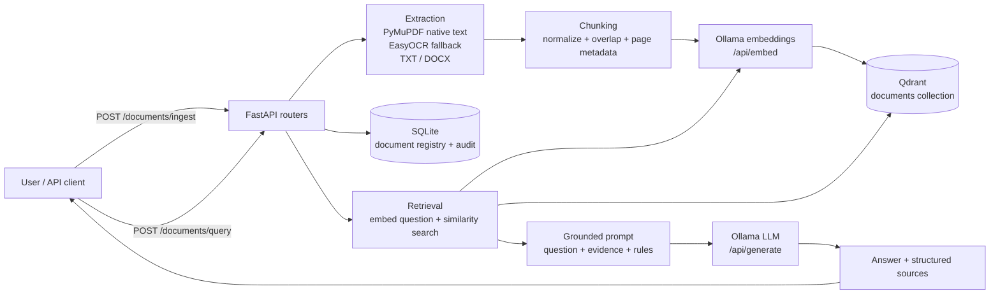

# SIRUS — Private Local RAG Knowledge Assistant

SIRUS is a locally runnable, retrieval-augmented generation (RAG) service. It turns
your documents into a private question-answering knowledge base:

**upload → extract → chunk → embed → store in Qdrant → retrieve → answer with
Ollama → return traceable source references.**

Nothing leaves your machine. SIRUS does not train or fine-tune a model. The
embedding model handles semantic retrieval, Qdrant stores vectors, and the local
LLM writes an answer grounded in retrieved passage text.

> V1 is designed for a trusted single-user local deployment. It has **no
> authentication**. Do not expose it to the public internet. The
> `/agent/execute_code` endpoint executes Python in a restricted subprocess and is
> a demo feature; disable or remove it before any shared deployment.

## Contents

1. [What SIRUS does](#what-sirus-does)
2. [Architecture](#architecture)
3. [Technology stack](#technology-stack)
4. [Prerequisites](#prerequisites)
5. [Installation](#installation)
6. [Environment configuration](#environment-configuration)
7. [Ollama model setup](#ollama-model-setup)
8. [Qdrant setup](#qdrant-setup)
9. [Docker instructions](#docker-instructions)
10. [Starting FastAPI natively](#starting-fastapi-natively)
11. [API endpoints](#api-endpoints)
12. [Example document ingestion](#example-document-ingestion)
13. [Example question and answer](#example-question-and-answer)
14. [Example source references](#example-source-references)
15. [Running tests](#running-tests)
16. [Common errors and fixes](#common-errors-and-fixes)
17. [Current limitations](#current-limitations)
18. [Changing the embedding model](#changing-the-embedding-model)
19. [Project layout](#project-layout)

## What SIRUS does

- Accepts `PDF`, `TXT`, and `DOCX` uploads with size/type/page validation.
- Extracts digital PDF text natively and falls back to EasyOCR only for
  image-only pages. TXT uses encoding fallbacks; DOCX reads paragraphs and tables.
- Normalizes text and produces overlapping, boundary-aware chunks with page
  numbers and stable chunk IDs.
- Generates embeddings through Ollama (`POST /api/embed`) in batches.
- Stores vectors, document IDs, chunk IDs, page numbers, excerpts, and hashes in
  Qdrant using deterministic point IDs.
- Keeps a SQLite document registry for listing documents, detecting duplicates,
  and guarding embedding-model/collection compatibility.
- Embeds the question with the same model, retrieves top-k chunks with an
  optional similarity threshold, and asks the local LLM to answer **only** from
  the retrieved evidence.
- Returns structured citations (document, chunk, page, score, excerpt) and says
  it cannot answer when evidence is insufficient.
- Reports liveness, dependency readiness (including whether the configured
  Ollama models are installed), and system status.

## Architecture



Data flow for ingestion:

1. `app/api/documents.py` streams the upload with a hard size cap.
2. `app/documents/extraction.py` validates the type and extracts per-page text
   (in a worker thread, so OCR/PDF parsing does not block the event loop).
3. `app/services/ingestion.py` checks the SHA-256 duplicate index, chunks each
   page with `app/rag/chunking.py`, probes the live embedding dimension, verifies
   collection compatibility, embeds in batches, and upserts points.
4. `app/services/document_registry.py` records document identity and chunk
   summaries in SQLite.

Data flow for a question:

1. `app/api/documents.py` validates the question.
2. `app/services/query.py` checks whether anything is indexed, then calls
   `app/rag/retrieval.py`.
3. Retrieval embeds the question and searches Qdrant with an optional
   `document_id` filter and score threshold.
4. `app/rag/prompts.py` builds the anti-hallucination system prompt and numbered
   evidence blocks.
5. The local LLM answer is normalized; an explicit "insufficient information"
   answer becomes `grounded: false`. Structured sources are returned regardless.

## Technology stack

- Python 3.11+ (Docker image uses 3.12)
- FastAPI + Uvicorn + Pydantic v2 / pydantic-settings
- Ollama for local generation and embeddings
- Qdrant for vector storage and cosine similarity search
- PyMuPDF for PDF parsing/rendering, EasyOCR for scanned pages
- python-docx for DOCX
- SQLite for the document registry and redacted audit events
- pytest / pytest-asyncio for tests

No LangChain, Redis, Kafka, agents, or graph database is used. The pipeline is
deliberately explicit and small enough to understand end to end.

## Prerequisites

- Docker Desktop with Docker Compose, **or**
- Python 3.11+ plus locally running Ollama and Qdrant.
- Approximately 6 GB free disk space for `llama3.1:8b` and
  `nomic-embed-text` (less for smaller models such as `qwen2.5:0.5b`).
- EasyOCR downloads recognition weights on first OCR use. Run one OCR PDF while
  online before relying on fully offline operation.

## Installation

Clone the repository and enter the project directory. Then either use Docker
(recommended for a first run) or create a virtual environment:

```powershell
py -3 -m venv .venv
.\.venv\Scripts\Activate.ps1
python -m pip install -r requirements-dev.txt
```

`requirements.txt` contains runtime dependencies; `requirements-dev.txt` adds
pytest tooling.

## Environment configuration

Copy the example file. **Never commit `.env`.**

```powershell
Copy-Item .env.example .env
```

The example defaults target Docker Compose. For native execution, change these
four values:

```dotenv
DATABASE_URL=sqlite:///./data/workbench.db
LLM_SERVICE_URL=http://localhost:11434
EMBEDDING_SERVICE_URL=http://localhost:11434
VECTOR_STORE_URL=http://localhost:6333
```

| Variable | Default | Purpose |
| --- | --- | --- |
| `APP_PROFILE` | `development` | `development`, `demo`, or `offline-demo` (local/private URLs enforced) |
| `DATABASE_URL` | `sqlite:///./data/workbench.db` | SQLite registry/audit database |
| `LLM_SERVICE_URL` | `http://localhost:11434` | Ollama generation endpoint |
| `EMBEDDING_SERVICE_URL` | `http://localhost:11434` | Ollama embedding endpoint |
| `VECTOR_STORE_URL` | `http://localhost:6333` | Qdrant REST endpoint |
| `QDRANT_COLLECTION` | `documents` | Collection name |
| `LLM_MODEL` | `llama3.1:8b` | Model used for RAG answers |
| `REASONING_MODEL` | `llama3.1:8b` | General agent model |
| `CODING_MODEL` / `VISION_MODEL` | `qwen2.5-coder:7b` / `llava:7b` | Agent routing models |
| `EMBEDDING_MODEL` | `nomic-embed-text` | Embedding model (must be installed) |
| `LLM_TEMPERATURE` | `0.1` | Generation temperature |
| `CHUNK_SIZE` | `800` | Target chunk size in characters |
| `CHUNK_OVERLAP` | `120` | Character overlap between chunks |
| `EMBEDDING_BATCH_SIZE` | `16` | Chunks per embedding request |
| `RETRIEVAL_TOP_K` | `4` | Default number of retrieved chunks |
| `RETRIEVAL_SCORE_THRESHOLD` | `0.25` | Minimum cosine score; `0` disables filtering |
| `ALLOWED_FILE_TYPES` | `pdf,txt,docx` | Accepted upload extensions |
| `MAX_UPLOAD_MB` | `10` | Upload size limit |
| `MAX_PAGE_COUNT` | `100` | PDF page limit |
| `MAX_EXTRACTED_CHARS` | `5000000` | Extracted-text safety cap |
| `MAX_CHUNKS_PER_DOCUMENT` | `2000` | Chunking safety cap |
| `OCR_ENABLED` | `true` | Enable OCR fallback for image-only PDF pages |
| `OCR_LANGUAGES` | `en` | Comma-separated EasyOCR languages |
| `OCR_DPI` | `200` | Render DPI for OCR |
| `PDF_NATIVE_TEXT_MIN_CHARS` | `40` | Below this, a page is OCR'd |
| `REQUEST_TIMEOUT_SECONDS` | `3` | Dependency probe timeout |
| `VECTOR_STORE_TIMEOUT_SECONDS` | `30` | Qdrant request timeout (collection creation is slower than probes) |
| `GENERATION_TIMEOUT_SECONDS` | `120` | LLM generation timeout |

Configuration is validated at startup. `CHUNK_OVERLAP` must be smaller than
`CHUNK_SIZE`; unsupported file types and non-SQLite database URLs are rejected.

### Chunking strategy and trade-offs

Chunks target 800 characters with 120 characters of overlap. Character sizing is
deterministic across embedding models and avoids tokenizer coupling. The splitter
prefers paragraph breaks, then sentence endings, then word boundaries near the
target size, and avoids tiny trailing fragments. Overlap preserves context across
boundaries but duplicates a small amount of text and embedding work. Page
numbers and character offsets are retained for citations.

## Ollama model setup

Start Ollama, then pull both models explicitly. Starting Ollama does **not**
download models automatically.

On the host:

```powershell
ollama pull nomic-embed-text
ollama pull llama3.1:8b
```

Inside Docker Compose:

```powershell
docker compose exec ollama ollama pull nomic-embed-text
docker compose exec ollama ollama pull llama3.1:8b
```

Or use the one-shot helper (reads `LLM_MODEL` and `EMBEDDING_MODEL` from `.env`):

```powershell
docker compose --profile setup run --rm ollama-models
```

For a lighter machine, set `LLM_MODEL=qwen2.5:0.5b` and pull that model. Answer
quality will be lower; the RAG pipeline is unchanged.

Verify readiness distinguishes process and model availability:

```powershell
Invoke-RestMethod http://localhost:8000/health/ready
```

If Ollama is reachable but a model is missing, the response is HTTP 503 with a
check detail such as `model 'nomic-embed-text' is not installed`.

## Qdrant setup

Qdrant is included in Docker Compose with persistent storage in the
`qdrant-data` volume. To run it alone:

```powershell
docker run --name sirus-qdrant -p 6333:6333 -v sirus-qdrant:/qdrant/storage qdrant/qdrant:v1.12.5
```

Qdrant is checked at `GET /healthz`. SIRUS creates the collection lazily on the
first ingestion; it never deletes or recreates an existing collection at startup.

## Docker instructions

```powershell
Copy-Item .env.example .env
docker compose up --build -d
docker compose --profile setup run --rm ollama-models
Invoke-RestMethod http://localhost:8000/health/ready
```

- The API is at `http://localhost:8000`, interactive docs at `/docs`.
- Qdrant is at `http://localhost:6333`.
- Ollama is at `http://localhost:11434`.
- `workbench-data` persists SQLite; `qdrant-data` persists vectors; `ollama-data`
  persists downloaded models.
- The API waits for Qdrant and Ollama health checks, but readiness still reports
  `degraded` until models are pulled.

If you prefer Ollama installed natively instead of the Compose service, remove or
stop the Compose `ollama` service, set `LLM_SERVICE_URL` and
`EMBEDDING_SERVICE_URL` to `http://host.docker.internal:11434`, and pull the
models with the host `ollama` CLI. Keep `VECTOR_STORE_URL=http://qdrant:6333`.

GPU acceleration for the Compose Ollama service requires
`nvidia-container-toolkit`; see the commented `deploy` block in
`docker-compose.yml`.

## Starting FastAPI natively

Ensure Ollama and Qdrant are running, then:

```powershell
.\.venv\Scripts\Activate.ps1
$env:DATABASE_URL="sqlite:///./data/workbench.db"
$env:LLM_SERVICE_URL="http://localhost:11434"
$env:EMBEDDING_SERVICE_URL="http://localhost:11434"
$env:VECTOR_STORE_URL="http://localhost:6333"
python -m uvicorn app.main:app --reload --port 8000
```

The app validates configuration on import and initializes SQLite schema during
the FastAPI lifespan. It does not contact Qdrant or Ollama at startup, so an
offline dependency produces a degraded readiness response rather than a crash.

## API endpoints

| Method | Endpoint | Purpose |
| --- | --- | --- |
| `GET` | `/health/live` | Process liveness (does not require dependencies) |
| `GET` | `/health/ready` | 200 only when SQLite, Qdrant, embedding model, and LLM model are usable |
| `GET` | `/system/version` | Application name/version |
| `GET` | `/system/status` | Profile, uptime, models, service hosts, checks, artifact status |
| `GET` | `/system/preflight` | Hardware summary and optional model artifact checks |
| `POST` | `/documents/ingest` | Upload and index a PDF/TXT/DOCX |
| `GET` | `/documents` | List indexed documents (`limit`, `offset`) |
| `GET` | `/documents/{document_id}` | Document details and chunk summaries |
| `POST` | `/documents/query` | Retrieve evidence and generate a grounded answer |
| `POST` | `/documents/analyze` | Extract text and summarize a document (legacy analysis flow) |
| `POST` | `/agent/generate` | General local-model generation |
| `POST` | `/agent/execute_code` | Demo Python execution — do not expose publicly |

Expected status codes: `200` success, `404` unknown document, `409` embedding
model/collection incompatibility, `413` oversize upload, `415` unsupported type,
`422` invalid/empty/unreadable document or invalid question, `503` unavailable
dependency. Error responses use `{"detail": "..."}` and a `request_id`.

### Ingestion behavior

- Supported extensions are validated **and** magic-checked (`%PDF-`, DOCX ZIP
  signature, text binary check).
- Empty, corrupted, binary, or no-text documents are rejected honestly.
- Duplicate content (same SHA-256 + embedding model + collection) returns the
  existing record with `"duplicate": true` instead of inserting new vectors.
- Chunk point IDs are deterministic UUIDv5 values (`document_id:page:index`), so
  retries cannot silently duplicate points.
- PDFs use embedded digital text first; OCR only runs for pages with fewer than
  `PDF_NATIVE_TEXT_MIN_CHARS` characters.
- DOCX and TXT have no reliable physical pages, so their citations use page `1`.

## Example document ingestion

Create a sample file:

```powershell
@"
SIRUS is a private knowledge assistant.
The project code name is ORION-7.
The project lead is Ada Lovelace.
The deployment region is the local workstation.
"@ | Set-Content -Encoding utf8 .\sample.txt
```

Upload it:

```powershell
curl.exe -X POST "http://localhost:8000/documents/ingest" `
  -F "file=@C:\path\to\sample.txt"
```

Abbreviated response:

```json
{
  "document_id": "6b1d7b5e-3f3a-4c9e-9f4f-0f0d5f3b8c21",
  "filename": "sample.txt",
  "page_count": 1,
  "chunk_count": 1,
  "duplicate": false,
  "embedding_model": "nomic-embed-text",
  "chunks": [
    {
      "chunk_id": "d8c4e3a2-...",
      "page": 1,
      "chunk_index": 0,
      "text_preview": "SIRUS is a private knowledge assistant..."
    }
  ]
}
```

List and inspect documents:

```powershell
Invoke-RestMethod http://localhost:8000/documents
Invoke-RestMethod http://localhost:8000/documents/<document_id>
```

## Example question and answer

```powershell
$body = @{
  question = "What is the project code name and who leads it?"
  top_k = 4
} | ConvertTo-Json
Invoke-RestMethod -Uri http://localhost:8000/documents/query `
  -Method Post -ContentType "application/json" -Body $body
```

Follow the retrieved evidence, the LLM should produce something like:

```json
{
  "answer": "The project code name is ORION-7, and the project lead is Ada Lovelace [1].",
  "model": "llama3.1:8b",
  "grounded": true,
  "sources": [
    {
      "citation_id": 1,
      "document_id": "6b1d7b5e-3f3a-4c9e-9f4f-0f0d5f3b8c21",
      "document_name": "sample.txt",
      "chunk_id": "d8c4e3a2-...",
      "page": 1,
      "chunk_index": 0,
      "score": 0.78,
      "text_preview": "SIRUS is a private knowledge assistant. The project code name is ORION-7..."
    }
  ]
}
```

Ask a question with no supporting evidence:

```powershell
Invoke-RestMethod -Uri http://localhost:8000/documents/query -Method Post `
  -ContentType "application/json" `
  -Body (@{ question = "What is the population of Mars in 3024?" } | ConvertTo-Json)
```

Expected behavior: `grounded: false`, empty or low-relevance retrieval rejected by
the threshold, and the fixed answer:

> I could not find enough information in the indexed documents to answer that
> question.

If retrieval returns weakly related chunks, the system prompt still instructs the
model to use only evidence and to admit insufficiency. `RETRIEVAL_SCORE_THRESHOLD`
is the tuning knob; raise it to be stricter, lower it (or set `0`) for recall.

## Example source references

Every source is derived from an actual Qdrant payload, never invented:

| Field | Meaning |
| --- | --- |
| `citation_id` | Number used as `[n]` in the answer |
| `document_id` | Stable registry/Qdrant document UUID |
| `document_name` | Sanitized uploaded filename |
| `chunk_id` | Qdrant point ID for the exact passage |
| `page` | 1-based PDF page, or `1` for TXT/DOCX |
| `chunk_index` | Chunk order within that page |
| `score` | Cosine similarity from Qdrant |
| `text_preview` | Up to 300 characters of retrieved evidence |

To trace an answer, take `document_id` to `/documents/{id}` and `chunk_id` to the
Qdrant payload in the configured collection.

## Running tests

```powershell
python -m pytest -q
```

The unit/API suite uses mock embedding, vector-store, and LLM adapters while using
real SQLite and chunking/extraction code. Mocked tests do **not** prove that your
Ollama/Qdrant installation works.

Live integration test (requires the real stack and models):

```powershell
$env:SIRUS_INTEGRATION="1"
$env:SIRUS_BASE_URL="http://localhost:8000"
python -m pytest tests/integration -v
```

Standalone smoke script (starts from a running API):

```powershell
python scripts/e2e_smoke.py --base-url http://localhost:8000
```

The smoke script ingests a unique text document, asks a grounded question,
verifies citations, and asks an unrelated question to verify refusal.

## Common errors and fixes

| Symptom | Cause | Fix |
| --- | --- | --- |
| `/health/ready` returns 503 with `embeddings` unavailable | Ollama down or embedding model missing | Start Ollama; `ollama pull nomic-embed-text` |
| `/health/ready` returns 503 with `llm` unavailable | LLM model missing | `ollama pull llama3.1:8b`, or change `LLM_MODEL` |
| `409` mentioning vector dimensions/model | Embedding model changed under an existing collection | Use a new `QDRANT_COLLECTION` and re-ingest, or rebuild as described below |
| `503` on ingest/query | Qdrant/Ollama down or model missing | Check `/health/ready`, service URLs, and container logs |
| `422` "No extractable text" | Blank/scanned PDF with OCR disabled | Enable `OCR_ENABLED=true`; ensure EasyOCR weights exist |
| First OCR request is very slow | EasyOCR downloading model weights | Pre-run OCR while online or mount a populated cache |
| `413` | Upload exceeds `MAX_UPLOAD_MB` | Raise the limit deliberately or split the file |
| `415` | Extension not in `ALLOWED_FILE_TYPES` | Convert the document or update configuration |
| Duplicate upload returns existing ID | Idempotent SHA-256 duplicate policy | Expected; re-ingest under a new collection/model if a fresh index is required |
| Docker API cannot reach Ollama | Wrong host from container | Compose uses `http://ollama:11434`; host Ollama uses `http://host.docker.internal:11434` |
| Database is read-only in Docker | Named volume permissions | Remove the volume only if data is expendable, or fix ownership |

Logs are structured and audit events are redacted. API errors do not expose
host paths, credentials, or stack traces.

## Current limitations

- Single-user, unauthenticated local deployment. Multi-tenant auth and multiple
  named knowledge bases are future work; collection name and document filters are
  the extension points.
- No delete/reindex HTTP endpoint yet. Rebuild instructions are below.
- DOCX/TXT page numbers are always `1`; only PDFs have real page metadata.
- OCR accuracy depends on scan quality; EasyOCR languages and DPI are configurable.
- The similarity threshold is model-dependent. Tune it with your embedding model.
- Structured sources are authoritative; the model's inline `[n]` markers are
  instructed but not semantically re-verified.
- Prompt injection inside documents is not fully mitigated; retrieved text is
  evidence, not trusted instructions.
- `/agent/execute_code` remains an unauthenticated demo endpoint.
- Vectors created by versions before the document registry can still be queried,
  but they do not appear in `GET /documents` until re-ingested (or migrated).
- The audit database and vector store are separate stores; there is no distributed
  transaction across them.

## Changing the embedding model

Embeddings from different models are not compatible even when dimensions match.
SIRUS checks both the Qdrant vector size and the registry's model metadata and
refuses incompatible ingestion with HTTP 409. **It never deletes existing data
automatically.**

Safest path (non-destructive):

1. Set `EMBEDDING_MODEL=<new-model>`.
2. Set `QDRANT_COLLECTION=documents_v2` (a new collection).
3. Restart the API and re-upload your documents.
4. The old collection and registry rows remain intact for rollback.

Reusing the same collection name is a destructive migration. Only do it after a
backup:

```sql
-- after deleting the Qdrant collection yourself
DELETE FROM documents;
DELETE FROM collection_state;
```

Deleting only the Qdrant collection while leaving registry rows causes future
duplicate uploads to be skipped. Back up `workbench-data` and `qdrant-data`
volumes before any rebuild.

## Project layout

```
app/
  main.py                 FastAPI factory, lifespan, middleware, error handlers
  dependencies.py         AppContainer wiring
  config.py               Typed environment settings and validation
  errors.py               User-facing exception taxonomy
  api/
    documents.py          Upload/list/detail/query/analyze routes + schemas
    system.py             Health and system routes
    agent.py              General generation and demo code execution
  documents/extraction.py PDF/TXT/DOCX validation and extraction
  rag/
    chunking.py           Normalization and overlapping chunking
    retrieval.py          Embedding + Qdrant search abstraction
    prompts.py            Grounded system/user prompts
  services/
    ingestion.py          End-to-end ingestion orchestration
    query.py              Retrieval + answer orchestration
    document_registry.py  SQLite document/collection metadata
  ai/
    embedding_ollama.py   Ollama /api/embed adapter
    vector_store_qdrant.py Qdrant REST adapter
  ocr.py                  PyMuPDF native text + EasyOCR fallback
  audit.py                Redacted SQLite audit events
tests/                    Unit, API, extraction, and integration tests
scripts/e2e_smoke.py      Live smoke test against a running API
```

## Documentation

- [Architecture notes](docs/architecture.md)
- [Local runbook](docs/runbook.md)
- [Learning guide](docs/learning-guide.md)
- [Epic 2 local models](docs/epic-2-local-models.md)
