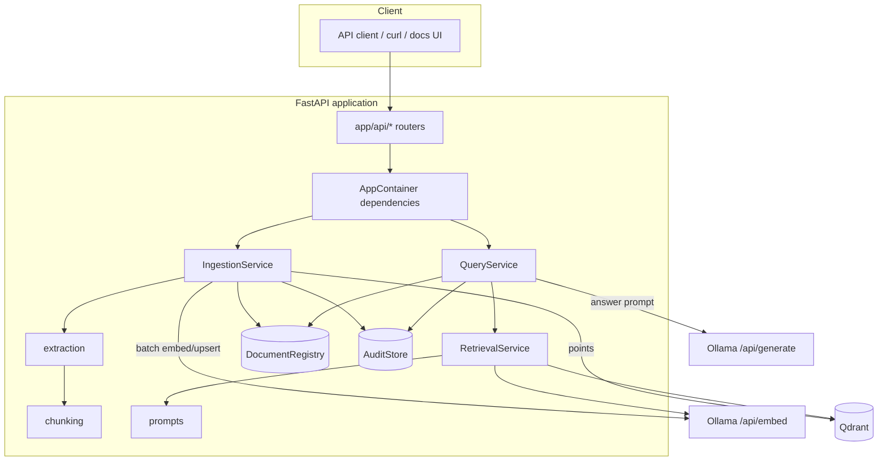

# SIRUS architecture

SIRUS V1 is a single-process FastAPI service plus two local dependencies:

- **Qdrant** for vector storage and cosine similarity search.
- **Ollama** for embeddings and text generation.
- **SQLite** for the document registry and redacted audit events.

## Module boundaries

| Layer | Responsibility | Files |
| --- | --- | --- |
| HTTP | Validation, status codes, schemas, error mapping | `app/api/*.py`, `app/main.py` |
| Orchestration | Ingestion and query workflows | `app/services/ingestion.py`, `app/services/query.py` |
| Domain/RAG | Extraction, chunking, retrieval, prompts | `app/documents/extraction.py`, `app/rag/*` |
| Adapters | Ollama and Qdrant REST clients | `app/ai/embedding_ollama.py`, `app/ai/vector_store_qdrant.py`, `app/llm_client.py` |
| Persistence | Document metadata, collection compatibility, audit | `app/services/document_registry.py`, `app/audit.py` |
| Configuration | Typed settings and validation | `app/config.py`, `app/dependencies.py` |

Routes never embed or search directly. `AppContainer` wires concrete adapters at
startup; tests construct the same container with fake providers.

## Ingestion sequence

1. FastAPI streams the upload with a size cap (`_read_upload_limited`).
2. `extract_document` validates extension + magic bytes, then:
   - PDF: native PyMuPDF text first, EasyOCR fallback per page.
   - TXT: UTF-8/CP1252/Latin-1 decoding.
   - DOCX: paragraphs and table rows.
3. SHA-256 + embedding model + collection identify duplicates in SQLite.
4. `chunk_text` normalizes whitespace and creates overlapping chunks with page
   number, chunk index, and character offsets.
5. The live embedding dimension is probed. Qdrant collection info is checked
   against that dimension and the registry's model metadata. Incompatible
   configurations return 409 and never delete data.
6. Chunks are embedded in batches and written with UUIDv5 point IDs. Payloads
   include document ID, filename, chunk ID, page, chunk index, content, and hashes.
7. Registry metadata is committed after the upsert. On failure, inserted points
   are deleted best-effort and no document row is committed.

## Query sequence

1. The route validates a non-empty question, optional `top_k`, optional document
   filter.
2. If the registry is empty, SIRUS checks whether a legacy collection contains
   points; otherwise it returns the fixed no-evidence answer without calling the
   LLM.
3. Retrieval embeds the question with the same embedding model, searches Qdrant
   (with an optional `document_id` filter), and drops chunks below the configured
   score threshold.
4. `build_rag_prompt` creates numbered evidence blocks and a strict system prompt.
5. The LLM answer is normalized. An explicit insufficiency response becomes
   `grounded: false`; dependency failures become HTTP 503, never a fake answer.
6. Structured sources always come from Qdrant payloads, so citations cannot be
   invented by the model.

## Failure semantics

| Dependency | Behavior |
| --- | --- |
| Qdrant unreachable | 503 on ingest/query; readiness `unavailable` |
| Ollama unreachable | 503 on embed/generate; readiness `unavailable` |
| Model not pulled | Readiness 503 with model-specific detail; ingest/query 503 |
| Collection missing | Treated as "no documents" for query; created on first ingest |
| Dimension/model mismatch | 409 with rebuild guidance; existing vectors untouched |
| Empty/no-text document | 422 |
| Unsupported type | 415 |
| Oversized upload | 413 |
| No relevant evidence | 200 with `grounded: false` and the no-evidence answer |

## Configuration invariants

- `CHUNK_OVERLAP < CHUNK_SIZE`.
- SQLite is the only supported metadata store in V1.
- `offline-demo` rejects public model/vector endpoints.
- `EMBEDDING_MODEL` must match the model that built the collection.
- `LLM_MODEL` and `EMBEDDING_MODEL` must exist in Ollama for readiness.

## Security posture

- Single-user, no authentication. Bind to localhost or a trusted network.
- Uploaded filenames are reduced to safe basenames and never used as paths.
- API errors are sanitized; audit payloads redact content/prompts/tokens.
- `/agent/execute_code` is a demo sandbox and must not be publicly exposed.
- Document prompt injection is not fully mitigated; retrieved text is evidence,
  not trusted instruction.
